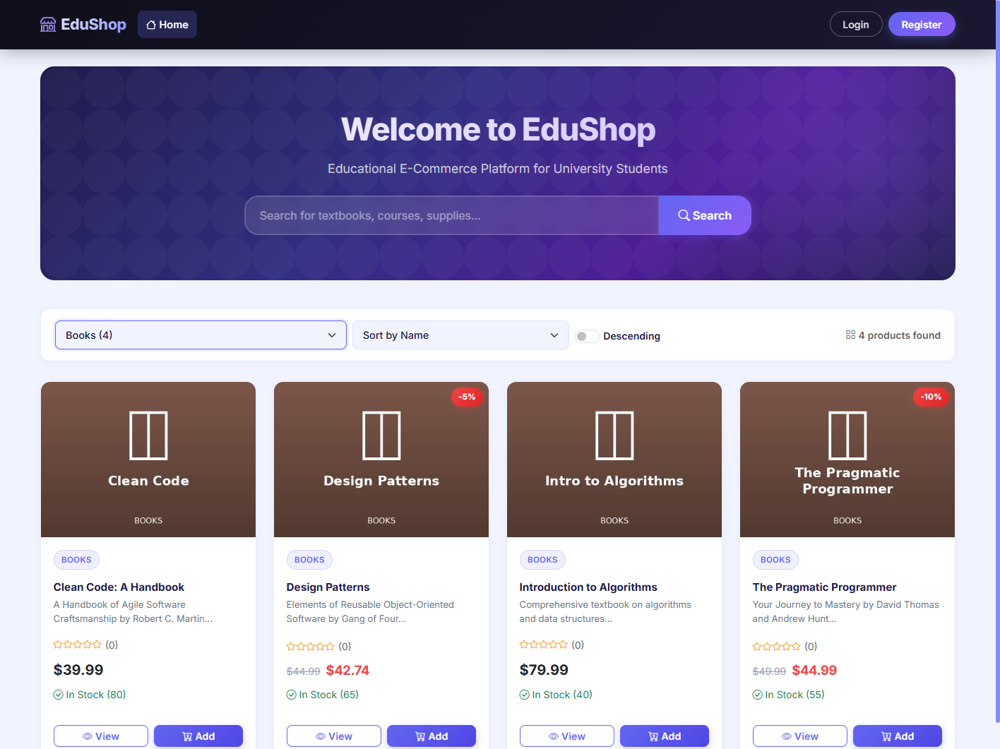
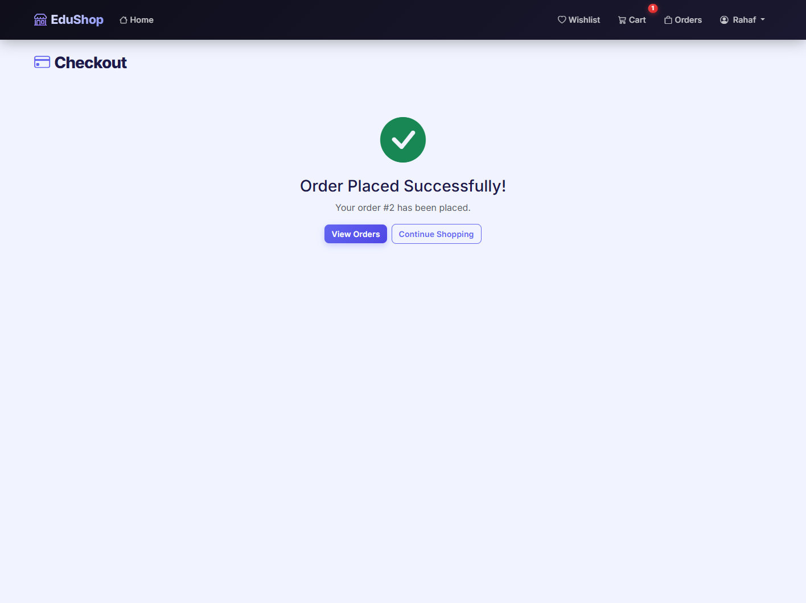

<div align="center">

# EduShop Selenium Java Automation

### Functional UI testing for the EduShop customer journey


[](https://github.com/QA-Dalil/EduShop-Selenium-Java-Automation/actions/workflows/ui-tests.yml)

</div>

## Overview

This project automates the [EduShop](https://github.com/BayanAlhassoun/E-Commerce-test-project-for-API---JMeter---Automation) Angular storefront using Selenium WebDriver, Java, JUnit 5, and Maven. Its 17 independent checks cover account validation, catalog filtering and sorting, wishlist and cart changes, checkout guards, and a complete new-customer purchase. The [test plan](docs/TEST_PLAN.md) lists each scenario.

**Verified run:** 17 tests passed with no failures or errors on local headless Edge. GitHub Actions runs the suite on Ubuntu with headless Chrome; its current status appears in the badge above.

## Test flow

```text
Register unique customer → log out and sign in → browse product → view reviews → add to wishlist
→ search → add to cart → checkout → verify order → logout
```

The tests use page objects, explicit waits, a new browser for each test, unique email addresses for authenticated scenarios, and screenshots on failure. The purchase test checks product stock through the API before starting and verifies the placed order through a customer-authenticated API request. Selenium Manager handles browser drivers automatically.

## Run locally

1. Install JDK 17+; use Edge or Chrome. The included Maven Wrapper downloads Maven automatically.
2. Start the EduShop app from its source repository with `docker compose up --build` and wait for `http://localhost:4200` and `http://localhost:5000`.
3. Use a disposable database with seeded products. The checkout test creates a real local order and consumes one Laptop unit. It checks stock before running. If stock is below five, set `EDUSHOP_ADMIN_EMAIL` and `EDUSHOP_ADMIN_PASSWORD` in your local environment so the test can restore it to 25 through the admin API. The cart tests add stocked Books products and do not place orders.
4. In this repository, run:

```powershell
.\mvnw.cmd test
```

Optional configuration:

```powershell
.\mvnw.cmd test -Dbrowser=chrome -Dheadless=false -DbaseUrl=http://localhost:4200 -DapiUrl=http://localhost:5000
```

Test results appear in `target/surefire-reports/`. Failure screenshots appear in `target/failure-screenshots/`. Both folders are ignored by Git. GitHub Actions uploads the reports and screenshots as a workflow artifact after every run, including successful runs.

## Evidence

| Category browsing | Order confirmation |
| --- | --- |
|  |  |

## Structure

```text
src/test/java/com/qadalil/edushop/
  pages/       Page objects for the real Angular screens
  support/     Browser lifecycle and failure screenshots
  tests/       Authentication, catalog, shopping, and purchase scenarios
docs/TEST_PLAN.md
docs/images/                 Two screenshots from the verified run
pom.xml
mvnw, mvnw.cmd, .mvn/wrapper/   Maven Wrapper
```

## Notes

- The test target is local EduShop; no account credentials are committed.
- The checkout UI offers Card, PayPal, BankTransfer, and CashOnDelivery. The journey uses CashOnDelivery; this is an order-placement test, not a payment gateway test.
- Tracked backend finding: [Order API omits the customer's email and name for their own order](https://github.com/QA-Dalil/EduShop-Selenium-Java-Automation/issues/1).
- Related project: [EduShop JMeter Performance Testing](https://github.com/QA-Dalil/EduShop-JMeter-Performance-Testing).
